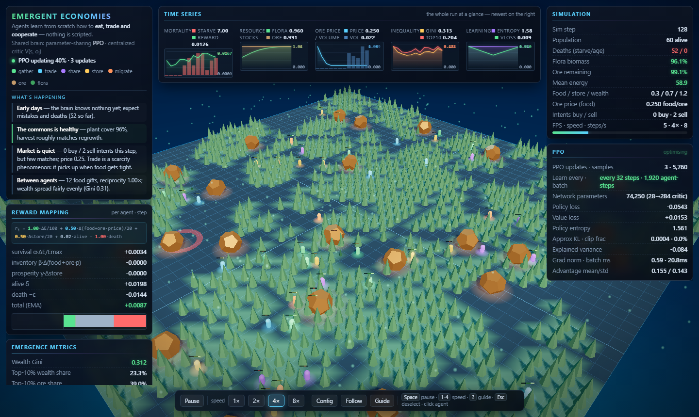
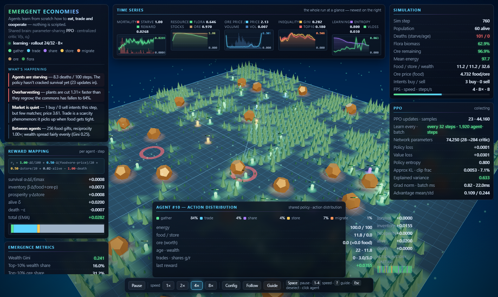
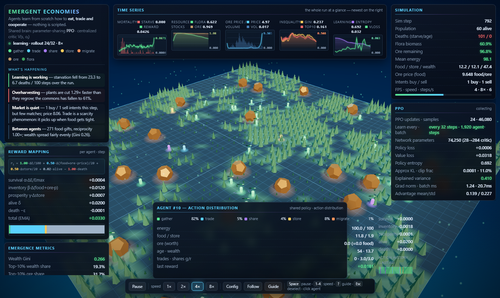

# Emergent Economies

**A 3D multi-agent reinforcement-learning economic simulation that runs entirely in the browser — no server-side inference, no Python, no scripted agents. Twenty to one hundred agents genuinely learn how to eat, trade, share and cooperate, while you watch.**

[](http://localhost:5173/)
[](./src/rl/ppo.js)
[](#quick-start)

---

## Screenshots

**Fresh world** — dusk gradient sky, star field, glowing world-border, additive grid, glowing flora/ore, agent light-pools, energy motes, UnrealBloom post-processing (toggle via `?fx=auto|high|low`, default `auto`):



**Post-learning world** — agents have spread out, depleted patches, market alive; agent inspector open (inventory, energies, action distribution, trail):



**Agent inspector** — action-probability distribution summed to 100%, reward components, energies:



---

## What is being simulated

A continuous 2-D economy on a coarse resource grid, where every visible behaviour
(resource scarcity, trading networks, cooperation, monopoly, mortality) *emerges*
from learned policy updates rather than hardcoded rules:

* **resource scarcity** — a renewable flora commons that can be over-exploited,
  and a non-renewable ore common-pool asset.
* **spatial trade networks** — bilateral matching within a trading radius, with an
  **adaptive market price** driven by the buy/sell imbalance of trade intents.
* **cooperation** — food sharing under a strict need/inequity test.
* **inequality & monopoly** — Gini / top-10% wealth concentration on the charts.
* **mortality & learning** — starvation curves that collapse as the policy improves.

---

## The equations

### Reward signal

$$
r_i = w_S\frac{\Delta E_i}{E_{\max}} + w_I\frac{\Delta\big(F_i + O_i\,p\big)}{R_I} + w_P\frac{\Delta S_i}{R_I} + w_A\,a_i - w_D\,d_i
$$

```
r_i = 1.00·ΔE/100                    survival   (energy)
    + 0.50·Δ(food + ore·price)/20    inventory value at market price
    + 0.50·Δstore/20                 long-term prosperity (banked food)
    + 0.02·alive − 1.00·death
```

with `E_max = 100`, `R_I = 20`, `w_S = 1.0`, `w_I = 0.5`, `w_P = 0.5`,
`w_A = 0.02`, `w_D = 1.0`. Inventory + prosperity weights are equal by design;
all terms are individually evaluated — there is **no** hand-coded cooperation bonus.

### PPO with centralized critic (MAPPO-style)

```
actor:   π(a | oᵢ)    oᵢ ∈ R²⁸
           ├── movement head: 2-D Gaussian, tanh-squashed, learned log σ
           └── mode head:       5-way categorical (gather · trade · share · store · migrate)

critic:  V(s, oᵢ) = f([oᵢ ; o₁..oₙ ; g(s)])    g ∈ R¹⁶ global features
```

Objective (PPO-clip surrogate + entropy):

$$
L^{CLIP}(\theta) = -\mathbb{E}_t\Big[\sum_{k=1}^{K}\Big(\rho_k^{CLIP}A_k - \tfrac{c_2}{K}\sum_{j=1}^{K}\bar\rho_j\bar F_j\Big) - c_3\,H(\pi)\Big]
$$

with importance ratio $\rho_k$, clip parameter `c = 0.2`, GAE ($δ_t = r_t + γV(s_{t+1}) − γV(s_t)$, $γ = 0.995$, $λ = 0.96$),
3 entropy-regularized epochs over minibatches of 128, Adam with global grad-norm
clipping, and an entropy bonus (`0.012`) on both heads.

### Flora logistic commons

$$
b_{t+1} = b_t + r\,b_t\Big(1 - \tfrac{b_t}{K}\Big) + I_t
$$

Uniform-harvest carrying-capacity equilibrium:

$$
x^* = \frac{1 + \sqrt{1 - \tfrac{4H}{C\,r\,K}}}{2}
$$

### Adaptive market price (tâtonnement)

$$
p_{t+1} = \mathrm{clip}\Big(p_t\,e^{\eta\frac{D_t - S_t}{D_t + S_t}},\, p_{\min},\, p_{\max}\Big)
$$

---

## Why the ecology holds together (the carrying-capacity budget)

The flora is a logistic commons on a patchy grid (`floraR·b·(1−b/K)` per cell, `K = 15`).
With `C = worldSize²·floraSeedFraction ≈ 1128` seeded cells and `r = 0.05`:

| quantity | value |
|---|---|
| peak production (at half fill) | `C·r·K/4` ≈ **212 food/tick** |
| population metabolic need (N=60) | `N·metab/eatEff` = **15 food/tick** |
| full-greed harvest (N=60) | `N·gatherFoodYield` = **96 food/tick** |
| learned policy (measured) | commons settles ~35% fill, mortality ≈ 0 |

`tests/carrying_probe.mjs` **validates this model empirically** against uniform
harvests H and reproduces the logistic equilibrium to ~2%,
$x^* = (1 + √(1 − 4H/(C·r·K)))/2$, and collapses the commons for H ≥ peak.

---

## Measured results

`node tests/learning_check.mjs 200 7` — 200 PPO updates, 6400 env steps, N=60,
vs. uniform-random policy in an identically-seeded world:

| metric (window 3840–6400) | random | trained |
|---|---|---|
| starvation deaths /step | 0.673 | **0.0016** (420× lower) |
| mean reward | 0.0085 | **0.0197** (+132%) |
| mean energy | 45.5 | **96.9** |
| flora commons | 98.2% | 35.9% (stable, oscillating 32–48%) |
| ore (non-renewable) | 98.2% | 74.0% (steady depletion) |
| sharing events | — | 921 |

### What happens when the ore runs out

The ore common-pool is **non-renewable** (finite nodes, depleted by mining). When
`ore` reaches 0:

1. **Mining stops** — node `stock` hits zero; `_doGather` falls through to flora
   harvesting, so the durable sink is permanently closed.
2. **Trading halts** — food↔ore deals can no longer execute (no ore to sell); the
   adaptive market price winds down toward its bounds.
3. **Wealth basis shifts** — `w = food + store + ore·price` reduces to
   `food + store`; agents can no longer bank ore value into the durable layer.
4. **The learned policy pivots** — the economy re-arms on flora gathering, banking
   (`store`) and sharing; mortality risk then rests on the flora commons alone.

---

## Architecture

```
world.js ──obs──▶ ppo.js (shared actor) ──mv/mode──▶ world.js ──events──▶ scene.js
   │                    ▲   │                                                   │
   │  rewards/dones     │   └─▶ buffer.js ─GAE─▶ chunked PPO update ◀─critic V(s,oᵢ)
   └────────────────────┴──────────────── centralized state ◀──────────────┘
                                        │
                             hud.js ◀── stats/history/charts ────────────────┘
```

---

## Quick start

```bat
START.bat          :: installs (first run) and serves on http://localhost:5173/
```

or manually:

```bash
npm install
npm run dev        # vite dev server
npm run build      # production bundle in dist/
```

Requires Node 20+ and a WebGL2-capable browser (any modern GPU; the renderer
degrades gracefully on software rasterisers — see *Performance*).

### URL parameters

| param | effect |
|---|---|
| `?pop=60` | population (20–100) |
| `?speed=4` | simulation speed 1/2/4/8× |
| `?seed=7` | world seed |
| `?T=32` | PPO rollout length (learns once per rollout) |
| `?render=0` | disable WebGL canvas |
| `?start=0` | skip intro |
| `?floraR=0.02` | low regrowth → commons collapse |
| `?fx=auto\|high\|low` | bloom post-processing (default `auto`) |

---

## Verification & tests

Every claim above is machine-checked. With the dev server running:

```bash
node tests/grad_check.mjs        # finite-difference check of ALL PPO gradients
node tests/sim_check.mjs         # 600-step numeric sanity
node tests/carrying_probe.mjs    # resource model vs logistic theory + heuristics
node tests/learning_check.mjs 200 7   # learning vs random baseline (~2 min)
node tests/e2e.mjs http://localhost:5173/   # Playwright: full UI walkthrough
node tests/perf_probe.mjs http://localhost:5173/  # frame-time attribution
```

`grad_check.mjs` caught two real bugs during development — the policy/entropy
gradients were written as *ascent* directions while Adam performs descent
(cosine = −0.69), and `MLP.backward()` re-applied the batch scale in every layer
(so layer *l* received `scale^(L−l)`). After the fixes: `cosine = 1.0000`.

---

## The dashboard

* **Time series (top strip)** — five charts: Mortality (starvation deaths vs. mean
  reward), Resource stocks (flora/ore), Ore price/volume, Inequality (Gini/top-10%),
  Learning (entropy, critic loss).
* **What's happening (left)** — plain-English narrative, refreshed ~1×/s.
* **Reward mapping (left)** — the live reward equation and its stacked contribution bar.
* **PPO panel (right)** — update count, rollout cadence ("learn every · batch → every
  32 steps · 1,280 agent-steps"), losses, entropy, KL, explained variance, gradient health.
* **Guide** (`?`/`h`, Esc) — plain-English overlay explaining the world, actions,
  reward function, and how to read the HUD.

---

## Performance

Frame time is dominated by rendering, not learning. Headless CI browsers
(Playwright) rasterise WebGL via SwiftShader in software (≈10–17 fps there); the
same scene is fill-rate-trivial on hardware GPUs. The renderer measures its own FPS
for the first 2.5 s and, only if below 24 fps, drops the **bloom pass first**, then
the shadow map to 1024², stops flora shadow casting and clamps pixel ratio —
full quality is kept on capable GPUs.

---

## Layout

```
index.html            HUD layout (metrics, charts, reward mapping, config, inspector)
src/main.js           loop, wiring, URL params, window.__EE test hooks
src/sim/world.js      economy: flora/ore, agents, actions, market, rewards, obs
src/rl/net.js         MLP + LogStd with analytic backprop (finite-diff verified)
src/rl/buffer.js      rollout buffer, GAE/returns
src/rl/ppo.js         MAPPO-style update, chunked per frame
src/render/scene.js   Three.js scene, instancing, trails, events, picking, bloom
src/ui/hud.js         HUD rows, charts, narrative, guide, config spec, inspector
tests/                grad / sim / carrying / learning / e2e / perf checks
```

---

## Limitations & future work

* Browser-only execution: WebGL2 + JS only, no server, no Python.
* PPO uses an on-policy rollout buffer (no long-lived replay buffer); `T` tunes
  the rollout horizon (`?T=16|32|64|128`).
* Centralized critic sees joint state; parameter sharing keeps one actor brain.
